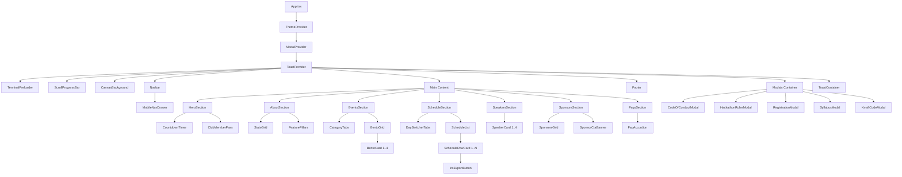

# UISPHERE 2.0 &mdash; React + TypeScript Porting Plan
**Project:** Tekno Krraft 2026 &mdash; Google Developer Group (GDG) @ SOA, ITER Chapter  
**Target:** Production-Grade Single Page Application (SPA) / Next.js Hybrid Architecture  
**Document Version:** 1.0.0 &middot; Canonical Migration Blueprint  
**Source Code Baseline:** `index.html` (1,493 lines), `app.js` (838 lines), `style.css` (3,258 lines), `DESIGN.md`

---

## Table of Contents
1. [Executive Summary & Migration Objectives](#1-executive-summary--migration-objectives)
2. [Source Codebase Audit & Architectural Mapping](#2-source-codebase-audit--architectural-mapping)
3. [Recommended Technology Stack & Tooling](#3-recommended-technology-stack--tooling)
4. [Target Project Directory Structure](#4-target-project-directory-structure)
5. [TypeScript Type Definitions & Domain Models](#5-typescript-type-definitions--domain-models)
6. [Global State Management & React Contexts](#6-global-state-management--react-contexts)
7. [Custom React Hooks Specification](#7-custom-react-hooks-specification)
8. [Component Hierarchy & Implementation Breakdown](#8-component-hierarchy--implementation-breakdown)
9. [Interactive Physics & Complex Logic Porting](#9-interactive-physics--complex-logic-porting)
   - [9.1. 3D Club Member Pass (Tilt, Glare & Floating Emblem)](#91-3d-club-member-pass-tilt-glare--floating-emblem)
   - [9.2. Sliding Pill Indicator with GPU Micro-Slides](#92-sliding-pill-indicator-with-gpu-micro-slides)
   - [9.3. Client-Side iCalendar (.ics) Generation](#93-client-side-icalendar-ics-generation)
   - [9.4. Zero-Flash Theme Boot & Snappy 180° Toggle](#94-zero-flash-theme-boot--snappy-180-toggle)
   - [9.5. Toast Notification Queue System](#95-toast-notification-queue-system)
   - [9.6. Staggered IntersectionObserver Card Reveals](#96-staggered-intersectionobserver-card-reveals)
10. [Styling Strategy & Design System Fidelity (`DESIGN.md`)](#10-styling-strategy--design-system-fidelity-designmd)
11. [Step-by-Step Phased Implementation Roadmap](#11-step-by-step-phased-implementation-roadmap)
12. [Accessibility (A11y), Performance & Edge-Case Safeguards](#12-accessibility-a11y-performance--edge-case-safeguards)
13. [Verification & Feature-Parity QA Matrix](#13-verification--feature-parity-qa-matrix)

---

## 1. Executive Summary & Migration Objectives

The current `UISPHERE 2.0` codebase powers the event portal for **Tekno Krraft 2026** (organized by GDG at SOA, ITER Chapter). While the existing application is visually polished, fast, and feature-complete, it is constructed as a monolithic, imperative triad: a 1,493-line `index.html`, an 838-line `app.js` with direct DOM manipulations, and a 3,258-line `style.css`.

### Migration Goals
1. **Type Safety & Maintainability:** Eliminate fragile DOM selectors (`document.querySelectorAll`, `getAttribute`, `classList.toggle`) by transitioning to strictly typed TypeScript interfaces for sessions, speakers, sponsors, modals, and registration data.
2. **Component Reusability & Declarative State:** Decouple monolithic markup into modular, composable React functional components (Atomic/Feature-driven architecture).
3. **Preserve Exact Micro-Interactions & Physics:** Maintain 100% visual and behavioral parity: the 3D tilting club member pass with glare shader, 60fps GPU scroll progress bar, sliding pill indicators, client-side `.ics` generation, terminal preloader, action toasts, and theme switching.
4. **Strict Design System Compliance:** Enforce all rules laid out in `DESIGN.md` (Matte Charcoal `#0F0F10`, GDG Blue `#4285F4`, 8px spacing grid, Space Grotesk / Plus Jakarta Sans / JetBrains Mono font stack, zero neon gradients).
5. **Decoupled Data Architecture:** Separate hardcoded HTML content into structured, static JSON/TypeScript data fixtures, paving the way for future CMS (Sanity, Strapi) or Firebase real-time integration.

---

## 2. Source Codebase Audit & Architectural Mapping

The current Vanilla codebase contains 18 interconnected functional subsystems in `app.js` and tightly-coupled HTML attributes. The table below maps each vanilla subsystem to its modern React + TypeScript idiom:

| Subsystem in `app.js` / `index.html` | Vanilla Implementation Pattern | React + TypeScript Target Pattern |
| :--- | :--- | :--- |
| **Theme System (Dark/Light)** | Inline `<script>` in `<head>`, `localStorage`, `data-theme` attribute on `<html>`, 180° rotation class | `ThemeProvider` + `useTheme` hook, inline zero-flash root script, `data-theme` synchronization |
| **Terminal Preloader** | `#preloader` with staggered timers (50ms, 300ms, 600ms, 900ms exit, 1000ms safety guard) | `<TerminalPreloader />` with `useState`/`useEffect` lifecycle, `sessionStorage` skip check |
| **Sticky Navbar & Mobile Drawer** | DOM class `.open` on `#mobile-drawer`, body scroll locking, click outside listener | `<Navbar />`, `<MobileNavDrawer />` controlled via boolean state, `useLockedBody` hook |
| **Top Scroll Progress Bar** | Global `scroll` listener with `requestAnimationFrame`, `scaleX` on `#scroll-progress-bar` | `useScrollProgress()` hook driving `transform: scaleX(progress)` with hardware acceleration |
| **Hero Countdown Timer** | `setInterval(updateCountdown, 1000)` mutating 4 `<span>` elements (`count-days`, etc.) | `useCountdown(targetDate)` hook returning `{ days, hours, minutes, seconds }` |
| **3D Club Member Pass** | `mousemove`, `mouseenter`, `mouseleave`, `touchmove`, math clamping to $\pm15^\circ$, CSS variables `--glare-x`, `--glare-y` | `useTilt3D()` hook, ref-based direct CSS variable binding or Spring-interpolated values |
| **Category Tabs & Sliding Pill** | OffsetLeft/Width calculation on click, `translateX` on pill, bento cards class toggle `.dimmed` | `<CategoryTabs />` + active filter state, measurement ref or layout-projection animation |
| **Cursor Bento Highlight** | `mousemove` on `.bento-card` setting `--mouse-x`, `--mouse-y` | `<BentoCard />` with localized pointer tracker setting CSS properties |
| **Day Schedule Switcher** | Button click toggling `.active`, hiding/showing `.schedule-row-card` by `data-schedule-day` | `<ScheduleSection />` filtering `sessionsData` by `selectedDay` state |
| **Calendar (.ics) Generator** | Click listener on `[data-ics-*]`, inline text array joined with `\r\n`, Blob + download link | Pure TS utility `generateIcsFile(session: ScheduleSession)` + trigger helper |
| **Accordions (FAQs)** | ForEach loop toggling `.open` and `aria-expanded` on click | `<Accordion />` and `<AccordionItem />` with controlled/uncontrolled expanded state |
| **Modals (Conduct, Rules, etc.)** | `[data-modal-target]`, backdrop click, Esc key listener, focus management | `ModalContext` managing active modal ID, accessible `<ModalDialog />` with focus trap |
| **Registration Form** | Form `submit` event, hiding form container, showing success banner, dispatching toast | `<RegistrationForm />` with React Hook Form + Zod schema validation, stateful success banner |
| **Action Toast System** | `showToast(msg, type)`, DOM creation, auto-removal timeout, reduced-motion check | `ToastContext` + `useToast()`, toast portal rendering queue with exit animations |
| **Scroll-Triggered Reveals** | `IntersectionObserver` with threshold 0.12, setting `--stagger-idx`, adding `.is-revealed` | `useIntersectionReveal()` hook or CSS-triggered motion wrapper |
| **Radial Click Ripple** | `pointerdown` creating `.click-ripple` element, coordinate calculation, `animationend` | `<RippleButton />` component or lightweight React ripple directive |

---

## 3. Recommended Technology Stack & Tooling

### Primary Option: Vite + React 19 + TypeScript (Fastest, Lightest SPA)
* **Core:** React 19 / 18, React DOM, TypeScript 5.5+
* **Build Tool:** Vite 6 with `@vitejs/plugin-react`
* **Routing:** `@tanstack/react-router` or lightweight `wouter` (if multi-route expansion is planned; for single-page smooth scrolling, native hash management is sufficient)
* **Form Handling & Validation:** `react-hook-form` + `zod`
* **Icons:** `lucide-react` (matching modern terminal/developer aesthetic, supplemented with custom GDG SVG logos)
* **Styling:** Tailwind CSS v4 / v3.4 configured with custom design tokens matching `DESIGN.md`, supplemented by custom CSS modules for 3D shaders and dot matrices.
* **Testing:** Vitest + React Testing Library + Playwright

### Alternative Option: Next.js 15 (App Router)
* **When to choose:** If server-side dynamic OpenGraph image generation, SEO pre-rendering for session speakers, and Next.js Server Actions for registration database persistence are required.

---

## 4. Target Project Directory Structure

```text
teknokrraft-portal/
├── public/
│   ├── assets/
│   │   ├── gdg-brackets.svg
│   │   ├── gdg-logo-dark.svg
│   │   ├── gdg-logo-stacked-dark.svg
│   │   ├── tekno-krraft-primary.png
│   │   └── client-gdg-logo.svg
│   ├── favicon.svg
│   └── site.webmanifest
├── src/
│   ├── assets/
│   │   └── (bundled vector assets and logos)
│   ├── components/
│   │   ├── common/
│   │   │   ├── Button.tsx
│   │   │   ├── Badge.tsx
│   │   │   ├── Modal.tsx
│   │   │   ├── ToastContainer.tsx
│   │   │   ├── Accordion.tsx
│   │   │   ├── SlidingTabs.tsx
│   │   │   └── RippleSurface.tsx
│   │   ├── layout/
│   │   │   ├── Navbar.tsx
│   │   │   ├── MobileNavDrawer.tsx
│   │   │   ├── Footer.tsx
│   │   │   ├── ScrollProgressBar.tsx
│   │   │   ├── TerminalPreloader.tsx
│   │   │   └── CanvasBackground.tsx
│   │   ├── sections/
│   │   │   ├── Hero/
│   │   │   │   ├── HeroSection.tsx
│   │   │   │   ├── CountdownTimer.tsx
│   │   │   │   └── ClubMemberPass.tsx
│   │   │   ├── About/
│   │   │   │   ├── AboutSection.tsx
│   │   │   │   ├── StatsGrid.tsx
│   │   │   │   └── FeaturePillars.tsx
│   │   │   ├── Events/
│   │   │   │   ├── EventsSection.tsx
│   │   │   │   ├── BentoGrid.tsx
│   │   │   │   └── BentoCard.tsx
│   │   │   ├── Schedule/
│   │   │   │   ├── ScheduleSection.tsx
│   │   │   │   ├── DaySwitcher.tsx
│   │   │   │   ├── ScheduleList.tsx
│   │   │   │   └── ScheduleRowCard.tsx
│   │   │   ├── Speakers/
│   │   │   │   ├── SpeakersSection.tsx
│   │   │   │   └── SpeakerCard.tsx
│   │   │   ├── Sponsors/
│   │   │   │   ├── SponsorsSection.tsx
│   │   │   │   ├── SponsorCard.tsx
│   │   │   │   └── SponsorCtaBanner.tsx
│   │   │   └── Faqs/
│   │   │       ├── FaqsSection.tsx
│   │   │       └── FaqAccordion.tsx
│   │   └── modals/
│   │       ├── CodeOfConductModal.tsx
│   │       ├── HackathonRulesModal.tsx
│   │       ├── RegistrationModal.tsx
│   │       ├── SyllabusModal.tsx
│   │       └── KrraftCodeModal.tsx
│   ├── context/
│   │   ├── ThemeContext.tsx
│   │   ├── ModalContext.tsx
│   │   └── ToastContext.tsx
│   ├── data/
│   │   ├── eventStats.ts
│   │   ├── featurePillars.ts
│   │   ├── bentoArenas.ts
│   │   ├── scheduleSessions.ts
│   │   ├── speakers.ts
│   │   ├── sponsors.ts
│   │   └── faqs.ts
│   ├── hooks/
│   │   ├── useTheme.ts
│   │   ├── useCountdown.ts
│   │   ├── useTilt3D.ts
│   │   ├── useScrollProgress.ts
│   │   ├── useIntersectionReveal.ts
│   │   ├── useSlidingPill.ts
│   │   └── useLockedBody.ts
│   ├── types/
│   │   ├── theme.ts
│   │   ├── schedule.ts
│   │   ├── event.ts
│   │   ├── speaker.ts
│   │   ├── sponsor.ts
│   │   ├── faq.ts
│   │   ├── registration.ts
│   │   └── toast.ts
│   ├── utils/
│   │   ├── icsGenerator.ts
│   │   ├── classNames.ts (cn)
│   │   └── constants.ts
│   ├── styles/
│   │   ├── globals.css
│   │   ├── tokens.css
│   │   └── animations.css
│   ├── App.tsx
│   ├── main.tsx
│   └── vite-env.d.ts
├── index.html
├── package.json
├── tsconfig.json
├── tsconfig.node.json
├── tailwind.config.ts
└── vite.config.ts
```

---

## 5. TypeScript Type Definitions & Domain Models

Create domain-specific TypeScript models to guarantee end-to-end type safety:

```typescript
// src/types/theme.ts
export type ThemeMode = 'dark' | 'light';

export interface ThemeContextValue {
  theme: ThemeMode;
  toggleTheme: () => void;
  setTheme: (theme: ThemeMode) => void;
}

// src/types/schedule.ts
export type ScheduleDay = 1 | 2 | 3;

export type SessionLevel = 
  | 'Keynote · All Levels' 
  | 'Workshop · Intermediate' 
  | 'Workshop · Beginner' 
  | 'Workshop · Advanced' 
  | 'Contest · Top 50 Finalists'
  | 'Esports · Open to All';

export interface ScheduleSession {
  id: string;
  day: ScheduleDay;
  timeRange: string;
  level: SessionLevel;
  title: string;
  speakerName: string;
  speakerRole: string;
  venue: string;
  roomCode?: string;
  calendarData: {
    startDate: string; // ISO 8601
    endDate: string;   // ISO 8601
    summary: string;
    description: string;
    location: string;
  };
}

// src/types/event.ts
export type EventCategory = 'all' | 'hackathon' | 'coding' | 'labs' | 'esports';

export interface BentoArenaItem {
  id: string;
  category: Exclude<EventCategory, 'all'>;
  colSpan: 1 | 2;
  badgeTag: string;
  prizePool?: string;
  isFeatured?: boolean;
  title: string;
  description: string;
  tags: string[];
  metaTiming: string;
  actionText: string;
  modalTarget: 'rules-modal' | 'cp-modal' | 'syllabus-modal' | 'register-modal';
}

// src/types/speaker.ts
export interface Speaker {
  id: string;
  name: string;
  role: string;
  organization: string;
  trackTag: string;
  avatarUrl: string;
  linkedinUrl: string;
}

// src/types/sponsor.ts
export type SponsorTier = 'Title Partner' | 'Platinum' | 'Gold' | 'Host Partner';

export interface Sponsor {
  id: string;
  name: string;
  tier: SponsorTier;
  websiteUrl: string;
  logoSrc?: string;
}

// src/types/faq.ts
export interface FaqItem {
  id: string;
  question: string;
  answer: string;
  defaultOpen?: boolean;
}

// src/types/registration.ts
export type RegistrationTrack = 
  | 'hackathon' 
  | 'gen-ai' 
  | 'web-cloud' 
  | 'mobile-flutter' 
  | 'coding-contest' 
  | 'gaming';

export interface RegistrationFormData {
  fullName: string;
  institutionalEmail: string;
  collegeName: string;
  track: RegistrationTrack;
}

// src/types/toast.ts
export type ToastType = 'info' | 'success' | 'warning' | 'error';

export interface ToastMessage {
  id: string;
  message: string;
  type: ToastType;
}

// src/types/modal.ts
export type ModalType = 'conduct' | 'rules' | 'register' | 'syllabus' | 'cp' | null;

export interface ModalContextValue {
  activeModal: ModalType;
  openModal: (type: ModalType) => void;
  closeModal: () => void;
}
```

---

## 6. Global State Management & React Contexts

Rather than introducing bulky state management libraries (Redux/Zustand) for a mostly static event portal, three lightweight React Contexts will manage dynamic application concerns:

### 6.1. ThemeContext (`src/context/ThemeContext.tsx`)
- Reads initial state from `localStorage` or `window.matchMedia('(prefers-color-scheme: dark)')`.
- Synchronizes with document element `<html data-theme="...">`.
- Implements smooth 200ms transitions and button spin states.
- Listens to system changes via `window.matchMedia`.

```tsx
import React, { createContext, useContext, useEffect, useState, useCallback } from 'react';
import { ThemeMode, ThemeContextValue } from '../types/theme';

const ThemeContext = createContext<ThemeContextValue | undefined>(undefined);

export const ThemeProvider: React.FC<{ children: React.ReactNode }> = ({ children }) => {
  const [theme, setThemeState] = useState<ThemeMode>(() => {
    if (typeof window !== 'undefined') {
      const stored = localStorage.getItem('theme') as ThemeMode | null;
      if (stored === 'dark' || stored === 'light') return stored;
      return window.matchMedia('(prefers-color-scheme: dark)').matches ? 'dark' : 'light';
    }
    return 'dark';
  });

  const setTheme = useCallback((newTheme: ThemeMode) => {
    setThemeState(newTheme);
    if (typeof window !== 'undefined') {
      localStorage.setItem('theme', newTheme);
      document.documentElement.setAttribute('data-theme', newTheme);
    }
  }, []);

  const toggleTheme = useCallback(() => {
    setTheme(theme === 'dark' ? 'light' : 'dark');
  }, [theme, setTheme]);

  useEffect(() => {
    document.documentElement.setAttribute('data-theme', theme);
  }, [theme]);

  return (
    <ThemeContext.Provider value={{ theme, toggleTheme, setTheme }}>
      {children}
    </ThemeContext.Provider>
  );
};

export const useTheme = () => {
  const ctx = useContext(ThemeContext);
  if (!ctx) throw new Error('useTheme must be used within a ThemeProvider');
  return ctx;
};
```

### 6.2. ModalContext (`src/context/ModalContext.tsx`)
- Centralizes modal visibility (`activeModal: ModalType`).
- Automatically handles `Escape` key listeners.
- Locks `document.body` scroll when a modal is open.
- Dispatches accessibility focus restoration on close.

### 6.3. ToastContext (`src/context/ToastContext.tsx`)
- Maintains an array queue of active toasts.
- Exposes `showToast(message: string, type?: ToastType)`.
- Automatically dismisses each toast after 2,600ms (respecting `prefers-reduced-motion`).

---

## 7. Custom React Hooks Specification

### 7.1. `useCountdown(targetDate: string)`
Calculates time remaining to October 16, 2026, 09:00 AM IST:
```typescript
// src/hooks/useCountdown.ts
import { useState, useEffect } from 'react';

interface CountdownResult {
  days: string;
  hours: string;
  minutes: string;
  seconds: string;
  isComplete: boolean;
}

export function useCountdown(targetIsoDate: string): CountdownResult {
  const targetTime = new Date(targetIsoDate).getTime();

  const calculateRemaining = (): CountdownResult => {
    const diff = targetTime - Date.now();
    if (diff <= 0) {
      return { days: '00', hours: '00', minutes: '00', seconds: '00', isComplete: true };
    }
    const days = Math.floor(diff / (1000 * 60 * 60 * 24));
    const hours = Math.floor((diff / (1000 * 60 * 60)) % 24);
    const minutes = Math.floor((diff / (1000 * 60)) % 60);
    const seconds = Math.floor((diff / 1000) % 60);

    return {
      days: String(days).padStart(2, '0'),
      hours: String(hours).padStart(2, '0'),
      minutes: String(minutes).padStart(2, '0'),
      seconds: String(seconds).padStart(2, '0'),
      isComplete: false,
    };
  };

  const [timeLeft, setTimeLeft] = useState<CountdownResult>(calculateRemaining);

  useEffect(() => {
    const timer = setInterval(() => {
      setTimeLeft(calculateRemaining());
    }, 1000);
    return () => clearInterval(timer);
  }, [targetIsoDate]);

  return timeLeft;
}
```

### 7.2. `useTilt3D<T extends HTMLElement>()`
Encapsulates pointer and touch physics for the 3D Club Member Pass:
```typescript
// src/hooks/useTilt3D.ts
import { useRef, useEffect, useState } from 'react';

export function useTilt3D<T extends HTMLElement>(maxTilt = 15) {
  const ref = useRef<T>(null);
  const emblemRef = useRef<HTMLDivElement>(null);
  const [isIdle, setIsIdle] = useState(true);

  useEffect(() => {
    const node = ref.current;
    if (!node) return;

    let animId: number | null = null;
    let resumeTimer: NodeJS.Timeout | null = null;

    const handlePointerMove = (e: PointerEvent) => {
      const rect = node.getBoundingClientRect();
      const x = e.clientX - rect.left;
      const y = e.clientY - rect.top;
      const centerX = rect.width / 2;
      const centerY = rect.height / 2;

      const rotateX = Math.max(-maxTilt, Math.min(maxTilt, -((y - centerY) / centerY) * maxTilt));
      const rotateY = Math.max(-maxTilt, Math.min(maxTilt, ((x - centerX) / centerX) * maxTilt));

      if (animId) cancelAnimationFrame(animId);
      animId = requestAnimationFrame(() => {
        node.style.transform = `perspective(1000px) rotateX(${rotateX.toFixed(2)}deg) rotateY(${rotateY.toFixed(2)}deg)`;
        node.style.setProperty('--glare-x', `${x}px`);
        node.style.setProperty('--glare-y', `${y}px`);
        if (emblemRef.current) {
          emblemRef.current.style.transform = `translateZ(65px) rotateX(${(rotateX * 0.25).toFixed(2)}deg) rotateY(${(rotateY * 0.25).toFixed(2)}deg)`;
        }
      });
    };

    const handleEnter = () => {
      setIsIdle(false);
      if (resumeTimer) clearTimeout(resumeTimer);
      node.style.transition = 'transform 80ms ease-out, border-color var(--transition-fast)';
      if (emblemRef.current) emblemRef.current.style.transition = 'transform 80ms ease-out';
    };

    const handleLeave = () => {
      if (animId) cancelAnimationFrame(animId);
      node.style.transition = 'transform 450ms cubic-bezier(0.22, 1, 0.36, 1), border-color var(--transition-fast)';
      node.style.transform = 'perspective(1000px) rotateX(0deg) rotateY(0deg)';
      if (emblemRef.current) {
        emblemRef.current.style.transition = 'transform 450ms cubic-bezier(0.22, 1, 0.36, 1)';
        emblemRef.current.style.transform = 'translateZ(65px) rotateX(0deg) rotateY(0deg)';
      }

      resumeTimer = setTimeout(() => {
        node.style.transform = '';
        node.style.transition = '';
        if (emblemRef.current) {
          emblemRef.current.style.transform = '';
          emblemRef.current.style.transition = '';
        }
        setIsIdle(true);
      }, 450);
    };

    node.addEventListener('pointermove', handlePointerMove);
    node.addEventListener('pointerenter', handleEnter);
    node.addEventListener('pointerleave', handleLeave);

    return () => {
      node.removeEventListener('pointermove', handlePointerMove);
      node.removeEventListener('pointerenter', handleEnter);
      node.removeEventListener('pointerleave', handleLeave);
      if (animId) cancelAnimationFrame(animId);
      if (resumeTimer) clearTimeout(resumeTimer);
    };
  }, [maxTilt]);

  return { ref, emblemRef, isIdle };
}
```

### 7.3. `useScrollProgress()`
Runs on requestAnimationFrame tick without re-rendering the whole tree, directly animating the top progress bar.

### 7.4. `useSlidingPill<T extends HTMLElement>()`
Computes active pill `offsetLeft` and `offsetWidth` dynamically on window resize or tab switch.

---

## 8. Component Hierarchy & Implementation Breakdown



### Detailed Component Specs:

1. **`TerminalPreloader.tsx`:**
   - 3 terminal lines: `> INITIALIZING_PORTAL...`, `> LOADING_ASSETS [OK]`, `> READY`.
   - Stagger timing: 50ms -> 300ms -> 600ms -> 900ms slide-up exit.
   - Hard safety guard at 1,000ms enforcing complete unmounting or pointer-events none.
2. **`Navbar.tsx` & `MobileNavDrawer.tsx`:**
   - Desktop: Height `64px` (`h-16`). Mobile: Height `56px` (`h-14`).
   - Blur backdrop, 1px border `#27272A`.
   - Animated SVG theme switch button with 180° rotation.
   - Smooth hash anchor links.
3. **`ClubMemberPass.tsx`:**
   - Holographic border, matte charcoal canvas.
   - Live badge counter, chip icon, 3D GDG floating emblem.
   - Glare shader overlay controlled via CSS custom properties.
4. **`EventsSection.tsx` & `BentoCard.tsx`:**
   - Filterable arenas: Flagship Hackathon (2-col), KrraftCode Finals (1-col), Specialization Labs (1-col), Tekno Gaming Night (2-col).
   - Mouse-tracking border highlight (`--mouse-x`, `--mouse-y`).
5. **`ScheduleSection.tsx` & `ScheduleRowCard.tsx`:**
   - Day 1, Day 2, Day 3 tabs with sliding indicator pill.
   - JetBrains Mono timestamps.
   - Instant client-side `.ics` generator button.
6. **`RegistrationModal.tsx`:**
   - Fully accessible modal dialog (aria-modal, role="dialog").
   - Controlled form input fields with validation.
   - Seamless transition to success state without full page reload.

---

## 9. Interactive Physics & Complex Logic Porting

### 9.1. 3D Club Member Pass (Tilt, Glare & Floating Emblem)
* **Vanilla Behavior:** Listens to `mousemove` on wrapper, computes delta from center, clamps rotation to $\pm15^\circ$, modifies `passCard.style.transform` and sets `--glare-x`, `--glare-y`.
* **React Solution:** Implemented via the `useTilt3D` custom hook. Use a React ref attached to the card container. Update CSS variables and 3D transforms using `requestAnimationFrame`. When the mouse leaves, smoothly animate back to upright position using `cubic-bezier(0.22, 1, 0.36, 1)` and reinstate the `.is-idle` CSS floating keyframe.

### 9.2. Sliding Pill Indicator with GPU Micro-Slides
* **Vanilla Behavior:** A floating `<div>` whose `transform: translateX(...)` and `width: ...px` are computed by querying `tab.offsetLeft` and `tab.offsetWidth`.
* **React Solution:**
  ```tsx
  // src/components/common/SlidingTabs.tsx
  import React, { useRef, useEffect, useState } from 'react';

  interface TabItem<T extends string> {
    id: T;
    label: string;
  }

  interface SlidingTabsProps<T extends string> {
    tabs: TabItem<T>[];
    activeTab: T;
    onSelect: (id: T) => void;
  }

  export function SlidingTabs<T extends string>({ tabs, activeTab, onSelect }: SlidingTabsProps<T>) {
    const containerRef = useRef<HTMLDivElement>(null);
    const [pillStyle, setPillStyle] = useState<{ transform: string; width: string }>({
      transform: 'translateX(0px)',
      width: '0px',
    });

    const updatePill = () => {
      if (!containerRef.current) return;
      const activeEl = containerRef.current.querySelector<HTMLButtonElement>(`[data-tab-id="${activeTab}"]`);
      if (activeEl) {
        setPillStyle({
          transform: `translateX(${activeEl.offsetLeft}px)`,
          width: `${activeEl.offsetWidth}px`,
        });
      }
    };

    useEffect(() => {
      updatePill();
      window.addEventListener('resize', updatePill);
      return () => window.removeEventListener('resize', updatePill);
    }, [activeTab]);

    return (
      <div ref={containerRef} className="events-tabs-wrapper" role="tablist">
        <div className="sliding-pill-indicator" style={pillStyle} aria-hidden="true" />
        {tabs.map((tab) => (
          <button
            key={tab.id}
            type="button"
            data-tab-id={tab.id}
            role="tab"
            aria-selected={activeTab === tab.id}
            className={`events-tab ${activeTab === tab.id ? 'active' : ''}`}
            onClick={() => onSelect(tab.id)}
          >
            {tab.label}
          </button>
        ))}
      </div>
    );
  }
  ```

### 9.3. Client-Side iCalendar (.ics) Generation
Extract RFC 5545 calendar file generation into a robust TypeScript utility:
```typescript
// src/utils/icsGenerator.ts
export interface IcsEventParams {
  title: string;
  timeRange: string;
  venue: string;
  startDate?: string;
  endDate?: string;
}

export function generateAndDownloadIcs({ title, timeRange, venue }: IcsEventParams): void {
  const cleanTitle = title.replace(/[^a-zA-Z0-9 ]/g, '');
  const icsLines = [
    'BEGIN:VCALENDAR',
    'VERSION:2.0',
    'PRODID:-//Tekno Krraft 2026//GDG ITER Chapter//EN',
    'BEGIN:VEVENT',
    `SUMMARY:Tekno Krraft 2026: ${title}`,
    `DESCRIPTION:Technical Session at Tekno Krraft 2026, GDG @ SOA, ITER Chapter. Scheduled: ${timeRange}`,
    `LOCATION:${venue}, ITER Campus, Bhubaneswar`,
    'STATUS:CONFIRMED',
    'END:VEVENT',
    'END:VCALENDAR',
  ];

  const blob = new Blob([icsLines.join('\r\n')], { type: 'text/calendar;charset=utf-8;' });
  const url = URL.createObjectURL(blob);
  const link = document.createElement('a');
  link.href = url;
  link.setAttribute('download', `${cleanTitle.replace(/\s+/g, '_')}.ics`);
  document.body.appendChild(link);
  link.click();
  document.body.removeChild(link);
  URL.revokeObjectURL(url);
}
```

### 9.4. Zero-Flash Theme Boot & Snappy 180° Toggle
To avoid theme flashing on initial page load:
1. Place an ultra-lightweight inline `<script>` in `index.html` before React mounts that inspects `localStorage` and `prefers-color-scheme`, immediately setting `document.documentElement.setAttribute('data-theme', theme)`.
2. Connect `ThemeProvider` to synchronize changes.
3. Implement the snappy 180° rotation on the SVG toggle button with `transition: transform 240ms cubic-bezier(0.22, 1, 0.36, 1)`.

### 9.5. Toast Notification Queue System
- Managed in `ToastContext`.
- Dispatches slide-up entrance: `translateY(12px) scale(0.95)` to `translateY(0) scale(1)`.
- Respects `prefers-reduced-motion: reduce` by replacing transitions with direct display toggles.

### 9.6. Staggered IntersectionObserver Card Reveals
Create a lightweight React hook `useIntersectionReveal` that attaches to grid parents, automatically assigns `--stagger-idx` to children, and removes `will-change` property after transition completion to prevent mobile GPU memory bloat.

---

## 10. Styling Strategy & Design System Fidelity (`DESIGN.md`)

The existing `style.css` contains 3,258 lines strictly mapped to `DESIGN.md`. The migration will preserve every design token and layout rule:

### 10.1. Color Tokens Mapping (`tokens.css` / Tailwind Config)
```css
:root, [data-theme="dark"] {
  --bg-canvas: #0F0F10;
  --bg-surface-1: #18181B;
  --bg-surface-2: #202024;
  --bg-surface-elevated: #27272A;
  --text-primary: #F4F4F5;
  --text-secondary: #A1A1AA;
  --text-muted: #71717A;
  --accent: #4285F4; /* Single Brand Accent */
  --accent-hover: #3B82F6;
  --accent-active: #2563EB;
  --accent-subtle: rgba(66, 133, 244, 0.08);
  --accent-border: rgba(66, 133, 244, 0.25);
  --border-subtle: rgba(255, 255, 255, 0.10);
  --border-strong: rgba(255, 255, 255, 0.18);
}

[data-theme="light"] {
  --bg-canvas: #FAF9F6;
  --bg-surface-1: #FFFFFF;
  --bg-surface-2: #F4F4F5;
  --bg-surface-elevated: #E4E4E7;
  --text-primary: #111111;
  --text-secondary: #71717A;
  --text-muted: #71717A;
  --border-subtle: rgba(0, 0, 0, 0.10);
  --border-strong: rgba(0, 0, 0, 0.18);
}
```

### 10.2. Strict Typography Guardrails
* Headings: `'Space Grotesk', -apple-system, sans-serif` (Weights: `600`, `700`, tracking: `-0.03em`)
* Body Text: `'Plus Jakarta Sans', -apple-system, sans-serif` (Weights: `400`, `500`, `600`)
* Metadata / Badges / Tags: `'JetBrains Mono', monospace` (Size: `12px`, uppercase, tracking: `0.05em`)
* **Strict Ban:** `Inter`, `Roboto`, `Arial` must never be imported or used.

### 10.3. Spacing, Borders & Shadows
* All padding, margins, and gaps snap strictly to the **8px scale** (`8px`, `16px`, `24px`, `32px`, `48px`, `64px`, `96px`).
* **Zero blurry drop shadows:** Elevation is achieved exclusively via crisp **1px solid border tokens** (`var(--border-subtle)`) and contrasting surface backgrounds.
* **Border Radius Discipline:** Outer cards = `12px` (`rounded-xl`), inner controls/buttons = `8px` (`rounded-lg`), progress bars = `6px`.

---

## 11. Step-by-Step Phased Implementation Roadmap

```
Phase 1: Project Setup & Tokens
  ├── Initialize Vite + React 19 + TypeScript
  ├── Configure fonts, Tailwind CSS, & CSS custom properties
  └── Copy static branding assets (SVGs, PNGs)
        │
Phase 2: Types & Data Fixtures
  ├── Create strict TypeScript definitions in src/types/
  └── Extract all hardcoded HTML data into src/data/*.ts
        │
Phase 3: Contexts, Utilities & Custom Hooks
  ├── Implement ThemeContext, ModalContext, ToastContext
  ├── Build useCountdown, useTilt3D, useScrollProgress
  └── Implement icsGenerator utility & cn() helper
        │
Phase 4: Global Layout & Background
  ├── CanvasBackground (Dot matrix & radial top spotlight)
  ├── ScrollProgressBar (60fps scaleX transform)
  ├── TerminalPreloader (900ms boot stagger + safety guard)
  └── Navbar & MobileNavDrawer with theme toggle
        │
Phase 5: Core Content Sections
  ├── HeroSection (Headings, CTAs, Countdown, 3D Member Pass)
  ├── AboutSection (4-Tile Stats Bento, 3 Feature Pillars)
  ├── EventsSection (Category sliding tabs & Bento grid)
  ├── ScheduleSection (Day filter, schedule list, .ics download)
  ├── SpeakersSection (Speaker cards with LinkedIn triggers)
  ├── SponsorsSection (Tier grid & sponsorship CTA banner)
  ├── FaqsSection (Accessible expandable accordion)
  └── Footer (Identity, links, guidelines, copyright)
        │
Phase 6: Modals & Form Submission
  ├── Base Modal component with backdrop & keyboard traps
  ├── CodeOfConductModal, HackathonRulesModal, SyllabusModal, CPModal
  └── RegistrationModal with React Hook Form validation & success state
        │
Phase 7: Micro-Interactions, Polish & A11y
  ├── Radial click-ripple physics on interactive elements
  ├── Cursor tracking highlight on Bento cards
  ├── Toast notification container
  └── IntersectionObserver scroll reveal system
        │
Phase 8: Testing, QA & Production Build
  ├── Unit testing hooks (useCountdown, useTilt3D, icsGenerator)
  ├── Lighthouse Performance, A11y, Best Practices audit
  └── Production bundle optimization & deployment preview
```

---

## 12. Accessibility (A11y), Performance & Edge-Case Safeguards

1. **Focus Trapping & Keyboard Traversal:**
   - When a modal opens, focus automatically transitions to the modal dialog close button.
   - Pressing `Escape` closes the active modal or mobile drawer.
   - Body scroll is locked via `overflow: hidden` without causing cumulative layout shift (CLS).
2. **Reduced Motion Optimization:**
   - Respect `prefers-reduced-motion: reduce`: disable 3D pass idle floating keyframes, disable radial ripples, and render toast notifications without scale transforms.
3. **GPU Memory & Transition Cleanup:**
   - When elements finish their scroll reveal or tilt return, immediately remove `will-change: transform` to release browser compositor resources.
4. **Zero-Flash Theme Boot Script:**
   - Placed in `index.html` to eliminate white flashes in dark mode before React hydrates.
5. **Asset Optimization:**
   - All speaker imagery configured with `loading="lazy"`, explicit `width` and `height` attributes to eliminate layout shifts.
   - Vector logos optimized with inline or external SVG sprites.

---

## 13. Verification & Feature-Parity QA Matrix

| Feature / Interaction | Expected Result in React + TypeScript | Acceptance Criteria |
| :--- | :--- | :--- |
| **Terminal Preloader** | Displays 3 terminal lines, slides out at 900ms, completely unmounts at 1000ms | No residual DOM elements; body acquires `.loaded` class |
| **Theme Switcher** | Toggles dark/light; persists in `localStorage`; smoothly rotates icon 180° | Zero flash on page reload; all `--bg-*` and `--text-*` variables transition |
| **Top Scroll Progress Bar** | Tracks scroll percentage from 0 to 1 at 60fps | GPU `scaleX` transform without triggering DOM reflows |
| **Countdown Timer** | Accurately calculates days, hours, mins, secs to Oct 16, 2026 09:00 IST | Numbers pad with leading zeros (`09`); updates every 1,000ms |
| **3D Club Member Pass** | Smoothly tilts toward cursor up to $\pm15^\circ$; glare coordinates track mouse; emblem floats at `translateZ(65px)` | Returns to neutral on mouse leave; floats gently when idle; works on touch devices |
| **Category Tabs** | Sliding pill follows active tab; bento cards filter with micro-slide | Active pill animates width & `translateX`; non-matching cards fade smoothly |
| **Day Schedule Switcher** | Switches between Day 1, Day 2, Day 3; indicator pill moves smoothly | Correct session rows displayed with micro-slide cross-fade |
| **Calendar (.ics) Export** | Clicking "Add to Calendar" generates and downloads a valid `.ics` file | File imports properly into Google Calendar, Apple Calendar, and Outlook |
| **FAQ Accordions** | Clicking a header expands/collapses the item with animated arrow rotation | `aria-expanded` updates correctly; accessible via keyboard `Enter`/`Space` |
| **Interactive Modals** | Clicking triggers opens corresponding modal; background is darkened; body scroll is locked | Closed via close button, backdrop click, or `Escape` key |
| **Registration Form** | Validates full name, institutional email, college, and track; switches to success banner | Validates input format; shows toast feedback; retains no broken states |
| **Toast Notifications** | Toasts appear at bottom-right with slide-up animation; auto-dismiss in 2.6s | Toasts queue cleanly; non-blocking; dismissible |

---

## 14. Conclusion & Next Steps

This plan establishes a complete, production-grade roadmap to convert `UISPHERE 2.0` into a modern React + TypeScript application while upholding 100% visual fidelity, strict adherence to `DESIGN.md`, and robust interactive physics. 

To commence development, execute **Phase 1** by bootstrapping the repository with Vite, setting up the configuration files, and defining the domain models in `src/types/`.

