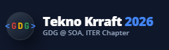

# Tekno Krraft 2026 &mdash; UISPHERE 2.0

<p align="center">
  
</p>

<p align="center">
  <strong>The Official Developer Gathering &amp; Hack Sprint Portal</strong><br/>
  Google Developer Group (GDG) &bull; Siksha 'O' Anusandhan (SOA), ITER Chapter, Bhubaneswar
</p>

<p align="center">
  
  
  
  
  
  
</p>

---

## 🌟 Overview

**Tekno Krraft 2026** is the flagship annual developer festival organized by the student community at **Google Developer Group, ITER Chapter**. Over three high-energy days (October 16–18, 2026), 1,500+ student builders, alumni working in tech, and invited engineers collaborate across hands-on labs, algorithmic programming, and a 24-hour non-stop AI/Cloud hack sprint.

**UISPHERE 2.0** is the official web portal for the gathering, engineered with a strict terminal-inspired developer design aesthetic, high-performance 60fps micro-interactions, hardware-accelerated 3D perspectives, offline-first registration, and client-side calendar and badge generation.

---

## ✨ Features

- **Interactive 3D Club Member Pass:**
  - Mouse & touch tilt physics clamped smoothly to $\pm15^\circ$.
  - Dynamic glare shader tracking cursor position (`--glare-x`, `--glare-y`).
  - True 3D parallax with a floating GDG emblem at `translateZ(65px)`.
  - Living idle float animation with smooth transition upon hover exit.
  - **Live Delegate Customizer:** Attendees can customize their badge with their own name, track, and export a high-resolution vector **SVG badge pass** with one click.
- **Live Countdown Timer:** Real-time day, hour, minute, and second countdown to kickoff on October 16, 2026, 09:00 AM IST.
- **3-Day Interactive Technical Schedule:**
  - Day 1, 2, and 3 sessions categorized by difficulty level, track, speaker, and venue.
  - Fluid sliding pill indicator tracking active tabs.
  - One-click **Add to Calendar** generating RFC 5545 client-side `.ics` files that import directly into Google Calendar, Apple Calendar, and Outlook.
- **Four Signature Event Arenas:** Filterable Bento Grid with hover cursor spotlights (`--mouse-x`, `--mouse-y`) spanning the 24-Hour AI/ML Hack Sprint, KrraftCode 2026 Finals, Specialization Labs, and Tekno Gaming Night.
- **Zero-Flash Theme System:** Dark Mode (Matte Charcoal `#0F0F10`) and Light Mode (Clean Off-White `#FAF9F6`) with persistent `localStorage` synchronization, system `prefers-color-scheme` listener, and snappy 180° toggle rotation.
- **Accessible Modals & Offline-First Registration:**
  - Dialogs for Community Code of Conduct, Hack Sprint Rules, Labs Syllabus, and Algorithmic Finals.
  - Full registration form with offline `localStorage` pass code generation (`#TK26-XXXXX`), input validation, and toast notifications.
- **60fps GPU Scroll Bar & Reveal Observer:** GPU `scaleX` scroll tracking and staggered card entrances via `IntersectionObserver`.

---

## 🛠 Tech Stack

| Domain | Technology |
| :--- | :--- |
| **Framework** | [React 18](https://react.dev/) + [TypeScript 5.7](https://www.typescriptlang.org/) |
| **Build Tool & Bundler** | [Vite 6](https://vitejs.dev/) |
| **Styling** | [Tailwind CSS 3.4](https://tailwindcss.com/) + CSS Custom Properties Design Tokens |
| **Typography** | `Space Grotesk` (Headings), `Plus Jakarta Sans` (Body), `JetBrains Mono` (Metadata) |
| **Testing** | [Vitest 5.1](https://vitest.dev/) + [JSDOM](https://github.com/jsdom/jsdom) |
| **CI / CD** | GitHub Actions Automated Test, Build & Pages Deployment |

---

## 🎨 Design System (`DESIGN.md`)

This portal adheres strictly to the canonical **UISPHERE 2.0 Design System Specification**:
- **Canvas Color:** Matte Dark Charcoal (`#0F0F10`) & Off-White (`#F4F4F5`).
- **Single Brand Accent:** Google Developer Group Blue (`#4285F4`). No competing rainbow or neon gradients.
- **Typography Stack:** Space Grotesk, Plus Jakarta Sans, and JetBrains Mono. Generic fonts (`Inter`, `Roboto`, `Arial`) are strictly prohibited.
- **Spacing Cadence:** Strict 8px mathematical grid (`8px`, `16px`, `24px`, `32px`, `48px`, `64px`, `96px`).
- **Depth & Elevation:** Crisp 1px solid borders (`var(--border-subtle)`) and flat elevated surfaces (`#18181B`, `#202024`) with zero blurry drop-shadows.

---

## 🚀 Getting Started

### Prerequisites
- Node.js (v20.x or v22.x recommended)
- npm (v10+ or v11+)

### Installation
```bash
# Clone the repository
git clone https://github.com/sky-ruler/UISPHERE2.0.git
cd UISPHERE2.0

# Install dependencies
npm install
```

### Running Locally
```bash
# Start development server with Hot Module Replacement (HMR)
npm run dev
```
Open [http://localhost:3000](http://localhost:3000) in your browser.

### Running Test Suite
```bash
# Run Vitest unit tests
npm test
```

### Production Build
```bash
# Type check and build optimized bundle
npm run build

# Preview production build locally
npm run preview
```

---

## 📦 Project Structure

```text
UISPHERE2.0/
├── .github/
│   └── workflows/ci.yml         # GitHub Actions Automated CI/CD
├── public/
│   └── assets/                  # GDG branding SVGs, logos, badges
├── src/
│   ├── components/
│   │   ├── layout/              # Navbar, MobileNavDrawer, Footer, Preloader, Progress
│   │   ├── modals/              # CodeOfConduct, Rules, Registration, Syllabus, CPModal
│   │   └── sections/            # Hero, About, Events, Schedule, Speakers, Sponsors, FAQs
│   ├── context/                 # ThemeContext, ModalContext, ToastContext
│   ├── data/                    # Typed datasets for sessions, speakers, and sponsors
│   ├── hooks/                   # useCountdown, useTilt3D, useScrollProgress, useSlidingPill
│   ├── services/                # registrationService (pass generation, localStorage cache)
│   ├── styles/                  # globals.css with design tokens & Tailwind utilities
│   ├── types/                   # Strict TypeScript domain interfaces
│   ├── utils/                   # cn, icsGenerator, passGenerator
│   ├── App.tsx                  # Root Application
│   └── main.tsx                 # Client bootstrap
├── tests/                       # Vitest unit test suite
├── DESIGN.md                    # Strict Design System rules
├── REACT_TS_PORTING_PLAN.md     # Architectural migration blueprint
├── vite.config.ts               # Vite configuration
└── tailwind.config.ts           # Design token configuration
```

---

## 📄 License

Distributed under the MIT License. See [LICENSE](LICENSE) for more information.

---

<p align="center">
  <strong>Tekno Krraft 2026 &bull; GDG @ SOA, ITER Chapter</strong><br/>
  Google Developer Group is an independent student group; activities and opinions expressed here are in no way linked to Google LLC.
</p>
